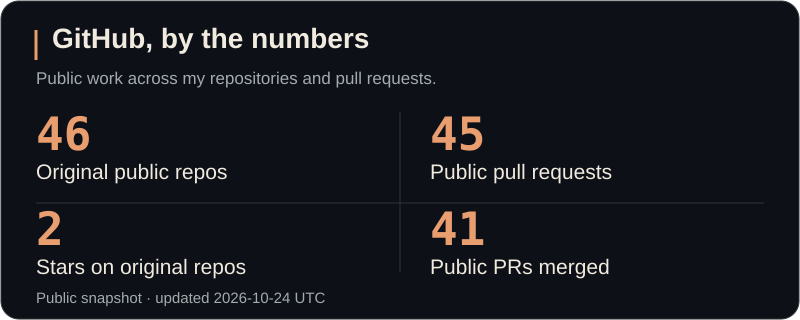
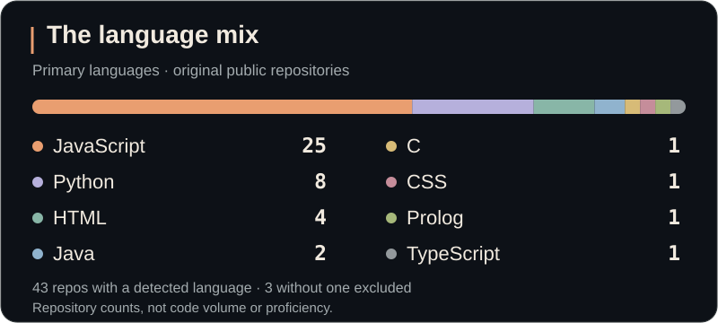
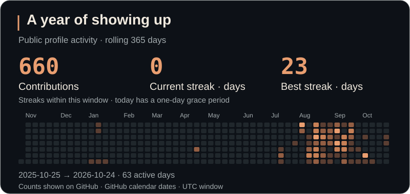
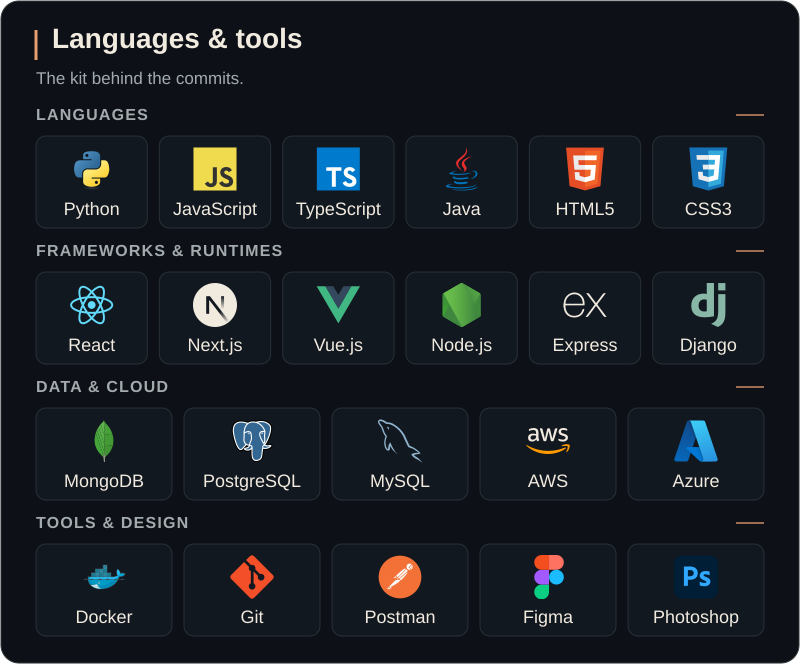

  <a href="https://github.com/raghammer1?tab=repositories"><strong>REPOSITORIES</strong></a>
  &nbsp; · &nbsp;
  <a href="https://github.com/search?q=author%3Araghammer1+is%3Apr&amp;type=pullrequests">Pull requests</a>
  &nbsp; · &nbsp;
  <a href="#github-in-numbers">Activity & stats</a>
  &nbsp; · &nbsp;
  <a href="https://raghav-agarwal.raghagarwal.workers.dev/">Portfolio ↗</a>

I'm **Raghav** — a software engineer in **Sydney**, currently at **Commonwealth Bank**. This is my workbench: tools, experiments, coursework and side projects across **Python, JavaScript/TypeScript and full-stack development**.

Some repositories are polished; others show the learning process. Here's a map into the code.

## GitHub in numbers

<a href="https://github.com/raghammer1?tab=repositories">
  <picture>
    <source media="(prefers-color-scheme: light)" srcset="assets/github-overview-light.svg" />
    
  </picture>
</a>

<a href="https://github.com/raghammer1?tab=repositories">
  <picture>
    <source media="(prefers-color-scheme: light)" srcset="assets/github-languages-light.svg" />
    
  </picture>
</a>

<a href="https://github.com/raghammer1#contribution-activity">
  <picture>
    <source media="(prefers-color-scheme: light)" srcset="assets/github-activity-light.svg" />
    
  </picture>
</a>

Snapshots from GitHub, refreshed daily. Language mix counts each original public repository once by its primary language. Activity reflects the contributions visible on my public profile; streaks use UTC dates.

[Read the stats as text →](assets/github-stats.md)

## Languages & tools

<picture>
  <source media="(prefers-color-scheme: light)" srcset="assets/toolkit-light.svg" />
  
</picture>

View the toolkit as text

- **Languages:** Python · JavaScript · TypeScript · Java · HTML5 · CSS3
- **Frameworks & runtimes:** React · Next.js · Vue.js · Node.js · Express · Django
- **Data & cloud:** MongoDB · PostgreSQL · MySQL · AWS · Azure
- **Tools & design:** Docker · Git · Postman · Figma · Photoshop

## Start with the code

<table>
  <tr>
    <td width="50%" valign="top">
      <h3><a href="https://github.com/raghammer1/Server-and-receiver-sim">Reliable transport over UDP ↗</a></h3>
      
<strong>How does a message survive packet loss?</strong> A networking learning project with acknowledgements, retransmission and simulated loss.

      
<code>Python</code> <code>UDP sockets</code>

      
Read the <a href="https://github.com/raghammer1/Server-and-receiver-sim/blob/main/sender.py">sender</a> and <a href="https://github.com/raghammer1/Server-and-receiver-sim/blob/main/receiver.py">receiver</a>.

    </td>
    <td width="50%" valign="top">
      <h3><a href="https://github.com/raghammer1/E-Invoicing-Backend">E-invoicing backend ↗</a></h3>
      
<strong>From a PDF to a structured invoice.</strong> Conversion to UBL XML, validation, storage and sharing. A university team project.

      
<code>Node.js</code> <code>Express</code> <code>MongoDB</code>

      
Explore the <a href="https://github.com/raghammer1/E-Invoicing-Backend/tree/main/backend/pdfConverter">converter</a>, <a href="https://github.com/raghammer1/E-Invoicing-Backend/tree/main/backend/routes">routes</a> and <a href="https://github.com/raghammer1/E-Invoicing-Backend/tree/main/backend/tests">tests</a>.

    </td>
  </tr>
  <tr>
    <td width="50%" valign="top">
      <h3><a href="https://github.com/raghammer1/sudoku2">Sudoku generator & solver ↗</a></h3>
      
<strong>A grid of constraints. A backtracking solver.</strong> Play a puzzle or build a custom board and solve it with recursive backtracking.

      
<code>JavaScript</code> <code>HTML</code> <code>CSS</code>

      
<a href="https://github.com/raghammer1/sudoku2/blob/main/sudoku-solver/script.js">Read the solver</a> · <a href="https://raghammer1.github.io/sudoku2/">Try it live</a>

    </td>
    <td width="50%" valign="top">
      <h3><a href="https://github.com/raghammer1/portfolio-website-2026">The portfolio, under the hood ↗</a></h3>
      
<strong>The implementation behind the interface.</strong> Interactive engineering demos, accessible navigation and browser checks.

      
<code>React</code> <code>TypeScript</code> <code>Playwright</code>

      
<a href="https://github.com/raghammer1/portfolio-website-2026/tree/main/src">Explore the source</a> · <a href="https://raghav-agarwal.raghagarwal.workers.dev/">See the result</a>

    </td>
  </tr>
</table>

## Keep exploring

[**All repositories →**](https://github.com/raghammer1?tab=repositories) · [Python](https://github.com/raghammer1?tab=repositories&language=python) · [JavaScript](https://github.com/raghammer1?tab=repositories&language=javascript) · [TypeScript](https://github.com/raghammer1?tab=repositories&language=typescript)

[Pull requests I've opened](https://github.com/search?q=author%3Araghammer1+is%3Apr&type=pullrequests) · [Merged contributions](https://github.com/search?q=author%3Araghammer1+is%3Apr+is%3Amerged&type=pullrequests) · [Things I've starred](https://github.com/raghammer1?tab=stars)

---

**Away from the commit history:** I explore science through [Unwinding Curiosity](https://www.youtube.com/@unwindingcuriosity). My [portfolio](https://raghav-agarwal.raghagarwal.workers.dev/) has the longer story behind my engineering work.

[Say hello](mailto:raghagarwal@gmail.com) · [LinkedIn](https://www.linkedin.com/in/raghav-agarwal-84a59822b/)
