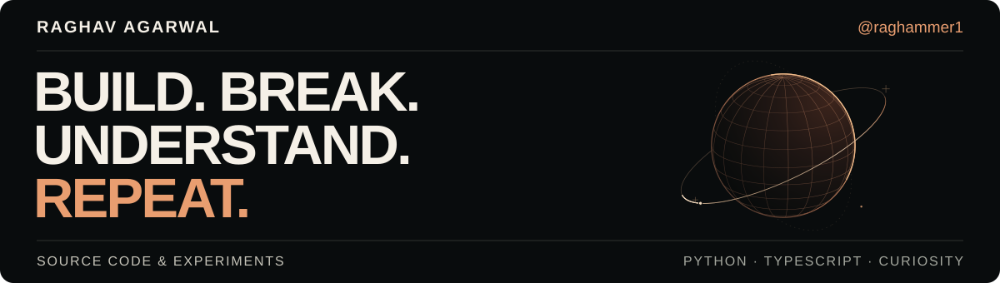

  <a href="https://raghav-agarwal.raghagarwal.workers.dev/"><strong>EXPLORE MY PORTFOLIO ↗</strong></a>
  &nbsp; · &nbsp;
  <a href="https://www.linkedin.com/in/raghav-agarwal-84a59822b/">LinkedIn</a>
  &nbsp; · &nbsp;
  <a href="mailto:raghagarwal@gmail.com">Say hello</a>

## A little context

I'm **Raghav**, a software engineer based in **Sydney**, currently working in retail credit decisioning at **Commonwealth Bank**. I build across Python, applied AI and full-stack development—with a particular interest in making complex systems faster, clearer and more useful.

Previously, I built full-stack software at **Axiom Technologies** and worked on Python and SQL reporting automation at **ABN AMRO Clearing Bank**. **Computer Science, UNSW.**

## 01 / Engineering in practice

| Focus | What I work on | Toolkit |
| :--- | :--- | :--- |
| **Python & data** | Rethinking expensive processing workflows and making data easier to work with. | Python · Polars · SQL |
| **Applied AI** | Developing LLM-assisted analysis with context, interpretability and human review. | RAG · Agent workflows · Langfuse |
| **Full-stack systems** | Connecting interfaces, application state, APIs and persistence. | React · Redux · Node.js · MongoDB |

[Explore the engineering case studies →](https://raghav-agarwal.raghagarwal.workers.dev/#work)

## 02 / Built out of curiosity

<table>
  <tr>
    <td width="50%" valign="top">
      <h3><a href="https://github.com/raghammer1/portfolio-website-2026">Engineering portfolio ↗</a></h3>
      
A space-inspired home for my work, with interactive engineering demos and accessible navigation.

      
<code>React</code> <code>TypeScript</code> <code>Playwright</code>

      
<a href="https://raghav-agarwal.raghagarwal.workers.dev/">Explore the site →</a>

    </td>
    <td width="50%" valign="top">
      <h3><a href="https://github.com/raghammer1/E-Invoicing-Backend">E-invoicing backend ↗</a></h3>
      
PDF → UBL XML conversion, validation, storage and sharing. A university team project.

      
<code>Node.js</code> <code>Express</code> <code>MongoDB</code>

      
<a href="https://github.com/raghammer1/E-Invoicing-Backend/tree/main/backend">Inspect the backend →</a>

    </td>
  </tr>
  <tr>
    <td width="50%" valign="top">
      <h3><a href="https://github.com/raghammer1/Server-and-receiver-sim">Reliable transport over UDP ↗</a></h3>
      
A networking learning project exploring acknowledgements, retransmission and simulated packet loss.

      
<code>Python</code> <code>UDP sockets</code>

      
<a href="https://raghav-agarwal.raghagarwal.workers.dev/#transport-preview">Try the interactive explainer →</a>

    </td>
    <td width="50%" valign="top">
      <h3><a href="https://github.com/raghammer1/sudoku2">Sudoku generator & solver ↗</a></h3>
      
Play a puzzle or build a custom grid. A recursive backtracking solver works through the constraints.

      
<code>JavaScript</code> <code>HTML</code> <code>CSS</code>

      
<a href="https://raghammer1.github.io/sudoku2/">Play a puzzle →</a>

    </td>
  </tr>
</table>

## 03 / Beyond the code

I like making things work. I like understanding **why** they work even more.

That curiosity led me to create [**Unwinding Curiosity**](https://www.youtube.com/@unwindingcuriosity), exploring science through articles and conversations, and to found the **UNSW Active Thinkers Society**.

---

**Interesting problem? Unfinished idea? Let's talk.** 
[raghagarwal@gmail.com](mailto:raghagarwal@gmail.com) · [LinkedIn](https://www.linkedin.com/in/raghav-agarwal-84a59822b/)

STAY CURIOUS. GO DEEPER.

